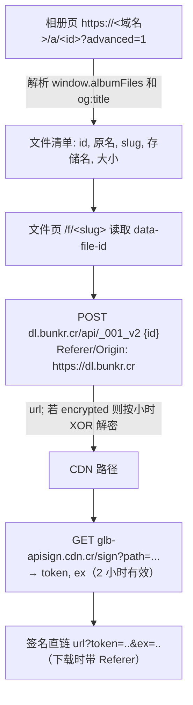
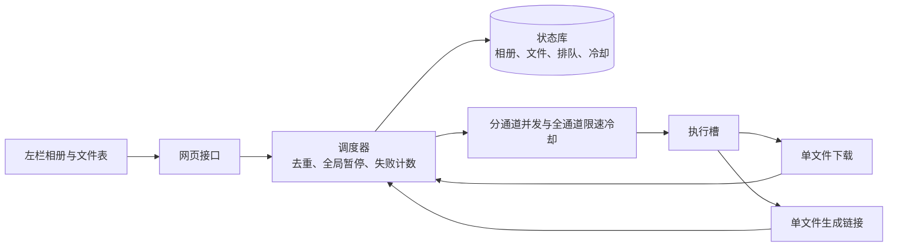

# VC-008 Bunkr 下载 — 设计

版本：v3.2（2026-11-03）。网页按用户第二轮试用反馈与 Codex 设计评审重做；v3.1 按真实相册实测收紧默认节奏，429/503 冷却改为按出口 IP 全通道停派发、指数退避与熔断。v3.2 按复核修正：Retry-After 超过 900 秒不再被截短、“需试探”独立持久化、升级保留未到期冷却、“继续”不清未到期冷却，并收紧请求日志。命令行保持串行。是否像 XArchive 一样独立成仓库，等网页验收后再定。

## 1. 需求

- 输入 Bunkr 相册链接（`/a/<id>`）或单文件链接，列出全部文件，记录原始文件名和大小；可以同时管理多个相册。
- 以文件为单位操作：选中文件后，**用本工具下载**，或**获取下载链接**（普通 HTTPS 直链，交给迅雷、IDM 等外部工具）。
- 外部工具下完后，**检查外部下载文件夹**：下好的改回原名并标完成；没下完或下坏的标失败，可再交给本工具补下。大小恰好对上、内容却是错误页（HTML、JSON 或报错文本）的也算下坏。
- 下载进度、失败原因、生成的链接都在页面上直接可见；出错的文件跳过，继续下一个。
- 每个文件的状态和排队列表都持久化，程序中断后可以继续。

## 2. Bunkr 下载流程（2026-10 参考 gallery-dl、Cyberdrop-DL 源码）



- 图片页面的 HTML 里只有缩略图地址，原图同样要走解析、签名两步（2026-10-26 实测），所以图片提速靠并发，不靠绕过签名。
- 链接末尾加 `n=<原名>`，CDN 会按原文件名返回（实测），外部工具能直接识别文件名。
- 域名、接口地址都放在配置里。命令行遇到 403、连接失败或人机验证会换镜像域名；网页遇到网络错误直接记失败，只在 403 时换一次镜像，遇到人机验证立即暂停全部。
- 不尝试绕过人机验证（DDoS-Guard/Cloudflare）。
- 签名直链 2 小时过期；重新下载一律重新签名。

## 3. 网页的调度与限流（v3）



| 项目 | 图片（含其他文件） | 视频 |
|---|---|---|
| 同时处理数 | 默认 2，可调 1–6 | 默认 1，可调 1–3 |
| 每个文件之后的等待 | 约 1 秒 | 2–4 秒 |

- 所有相册共用一个队列，按加入顺序执行；同一个文件同时只能有一个工作项。
- 所有请求共用一个节流器，两次请求的开始时间至少间隔 0.7 秒：相册页、文件页、签名接口、以及 CDN 文件体下载（含续传）都要先过这个节流器。
- 单个文件出错：记为失败并写明原因，继续下一个，不再重试同一个文件（瞬时网络错误例外，见下）。“重试失败的”按原来的操作重新入队。
- 按完成顺序统计，连续 3 个文件失败就暂停全部，原因一直显示；中间有一个成功就重新计数。遇到人机验证立即暂停全部。429/503 不计入这 3 个失败，改按下面的限速规则处理。
- **限速冷却对出口 IP 生效，所有通道一起停**：收到 429 或 503（含 Retry-After 的维护页）后，冷却期内不派发任何新文件，图片和视频都一样；已经在下的文件体不打断，下完照常记账。冷却期限取 Retry-After 与退避值的较大值并持久化。添加相册的解析请求也走同一个节流器；解析时收到 429/503 同样登记到这个冷却，冷却期内点“添加”直接返回“建议等待 N 秒”，不再发请求。
- **指数退避**：第 n 次连续被限速的冷却 = max(Retry-After, min(900, `web_cooldown` × 2^(n−1)))，`web_cooldown` 默认 120 秒。900 秒上限只压本工具自己的退避步长（120 → 240 → 480 → 900），Retry-After 更长就按 Retry-After，不截短。任一文件成功完成就把连续次数清零。冷却截止时间、连续次数和“还需试探”标志存在状态库（`web:ratelimit:until`、`web:ratelimit:streak`、`web:ratelimit:probe`），重启后保留。“还需试探”以该独立标志为准：冷却期内有在飞文件成功时连续次数已经清零但仍欠一次试探，只看次数会让冷却到期后直接放全并发。旧库没有该键时按连续次数大于 0 推断。v3.1 的分通道键 `web:lane:image:cooldown_until`、`web:lane:video:cooldown_until` 若未到期，首次加载时并入全局冷却（取最大值）并置需试探，之后忽略这两个键。
- **冷却到期只放 1 个试探**：冷却结束后先放 1 个文件（不分通道），成功才恢复到设置的并发；试探又被限速就按退避进入下一级冷却。试探遇到限速以外的失败，说明网站还在正常应答，恢复并发但连续次数保留。
- **恢复时把槽错开**：冷却期间没有槽刷新自己的文件间隔，冷却到期时所有槽的期限都已过期，恢复（含试探成功后回到设置的并发）那一刻会同时开工。所以从“冷却/试探”回到正常派发时，给每个槽重设 `ready_at = now + 各自的间隔随机抖动`，从第 1 个槽起逐个错开一个间隔，不再几个槽一起发请求。
- **瞬时错误自动重试 1 次**：网页里单个文件遇到连接超时或连接失败，等服务 5 秒在原地重试 1 次（暂停会打断等待）；仍失败才记失败。读文件体途中断流（urllib3 的 ProtocolError、IncompleteRead、ReadTimeoutError，requests 的 ChunkedEncodingError、截断引起的 ContentDecodingError，以及连接重置、管道断开、socket 超时）同样算瞬时错误，说明写作“下载中断”，阶段显示文件体；HTTP 4xx/5xx、内容校验失败、人机验证、磁盘与权限错误不算。限速、人机验证、文件不存在、大小不符不在网页里重试。
- **熔断**：连续 4 次被限速就暂停全部，暂停原因为 `ratelimit`：“被网站连续限速，已暂停。建议降低并发或等一会儿再继续”。用户点“继续”后只清连续次数并置“需试探”，**不清未到期的冷却**：截止时间保留原值（剩余超过最小冷却 `web_cooldown` 也不缩短），到期后才放 1 个试探，此后按最小步长的退避重新计数。被限速的文件不计入“连续 3 个失败”，两种暂停与人机验证暂停互不覆盖。
- 跨进程任务锁由调度器统一持有：有活动项时持锁，全部停下并写入状态库后释放。中断恢复只在启动时、没有活动项时执行一次。
- 重启后保留排队列表，处于暂停状态，等用户点“继续”。
- 网页上修改状态的操作（添加、移除、跳过、标为完成、检查外部下载文件夹、清除记录）都交给调度器执行；排队中的文件可以勾选后“取消排队”，取消只删除工作项；还没开始处理的文件保持入队前的状态（待下载、失败或链接已生成），之后可以重新入队。已经以“下载”开始过一次、又被暂停中断的文件会停在待下载，旧下载链接按 §5.1 不再保留。正在处理的文件不能单独取消，接口返回 409 并提示“正在处理，请稍后或使用‘暂停全部’”；同一次请求混有正在处理的文件时整批都不取消。等它结束，或先暂停全部。清除记录见 §5.4，只删记录不删文件。

命令行保持原来的串行规则：一次一个文件，文件间隔 3–6 秒，每 20 个文件暂停 30 秒，单个文件快速重试 2 次。快速重试之外，命令行结束前还会对可重试类错误（限速 429/503、临时网络错误、维护占位、大小不符）再补跑一轮（`downloader.ROUND_RETRY_KINDS`）；失败文件本身仍不自动重试。命令行和网页共用状态库与任务锁，同一时间只有一边在下载。

通用保护（命令行和网页都有）：维护占位视频或页面记失败、不保存；下载完成后校验大小与内容；`.part` 断点续传并记录归属，不认领、不覆盖别人的文件；User-Agent 用常见桌面浏览器。

## 4. 目录与文件名

- 每个相册一个下载目录：`<下载根目录>/<相册标题> [<相册ID>]`，记在状态库里。v3 之前已有的相册沿用原来的 `<相册标题>/` 目录，但这是启发式判定：仅当旧目录存在、且本相册有记录指向该目录（已下载记录、本地路径的父目录、本工具的 `<文件名>.<token>.bunkrdl.part` 归属信息），或旧目录里的 `.part` 归属信息指向本相册时才沿用；否则用 `<相册标题> [<相册ID>]/`。续传不受影响。
- 最终文件名为相册清单里的原名，去掉 Windows 不允许的字符，限制长度；同一相册内重名追加 ` (2)` 等后缀。下载、链接里的 `n=` 和外部文件检查用同一套命名。例外：若目标目录已存在同名的外来文件（非本工具记录），落盘会加 ` (2)`，此时 `n=` 链接名与磁盘名可能不同；外部检查按记录的 `local_path` 与 `cdn_name` 兜底匹配，不依赖 `n=` 名。
- 选择保存路径和登记归属在同一个临界区内完成，并发时不会两个文件抢同一个名字。若上次在“文件已落盘、状态还没记账”时中断，恢复后直接认领那个文件：大小已知时按大小核对，大小未知时按内容核对（错误页、未知格式不认领，交给用户手动确认）。
- CDN 存储名记为 `cdn_name`，检查外部下载文件夹时用它匹配外部工具保存的文件。
- 命令行 `links` 仍会写出分卷文件（`part-NN-links.txt`、`part-NN-aria2.txt`、`part-NN-rename_map.csv`）；网页直接在文件表里显示链接。

## 5. 代码结构

Python 3.11+，只依赖标准库和 `requests`。测试用 `unittest`，全部离线。

```
bunkrdl/
  models.py      数据结构与异常
  worktypes.py   v3 调度共享类型：工作项、单文件结果、入队结果、执行上下文
  config.py      默认配置与 config.toml 覆盖
  messages.py    中文错误与等待说明
  resolver.py    BunkrClient：解析、签名；支持共享节流与网页的快速失败
  store.py       SQLite 状态库：相册（含目录、隐藏）、文件、排队、元数据
  downloader.py  单文件下载、续传与校验；命令行的串行队列 run_queue
  export.py      单文件生成链接、下载链接格式；命令行的分卷写出
  reconcile.py   外部下载文件夹检查
  confirm.py     手动标为完成
  guard.py       跨进程任务锁；命令行的节奏控制
  limiter.py     网页的请求节流、分通道并发与全通道限速冷却（RateLimitGate）
  requestlog.py  每个请求写一行到 web.log（1 MB × 3 轮转）：只记主机、状态码、耗时，不记 token 与完整 URL；Retry-After 只记解析后的整数秒（HTTP 日期同样换算成秒），无法解析记 `invalid`、缺失记 `none`，原文不入日志；文件体在收到响应头之后超时或断流时，在前面的头行之后补一行错误（异常类型、从该请求开始的耗时、同一请求序号 `seq`），两行可对应；日志写入或轮转失败静默，不向 stderr 打印日志内容
  jobqueue.py    网页调度器 Coordinator
  flows.py       流程层：单文件下载、目录规则、命令行流程
  cli.py         命令行
  web.py         本地网页
  launcher.py    pywebview 桌面启动器、单实例与关闭确认
```

文件体下载复用 `BunkrClient` 自己的 `requests.Session`（连接池与代理设置一起复用）；网页每个并发槽各有一个 client 和 session，同一 Session 不会跨线程共用。

失败原因统一由 `messages.describe_error` 生成，格式为“中文说明 · 阶段：文件体 · 主机 cdn.example · 建议等待 120 秒”：阶段取相册页、解析、签名、文件体之一；主机只留域名（带非默认端口），不写完整 URL、路径、查询串与 token；建议等待按 Retry-After 或冷却期限给出。

方案 A：启动器只是外壳，调度、限速、下载逻辑一概不动；后续可再打包为 EXE（方案 B）。桌面依赖额外的 pywebview，Windows 10 使用 WebView2 Runtime。


桌面锁独立于任务锁，按状态库路径区分；本机带随机口令的通知端口用于唤起已有窗口。关闭确认采用窗口内三按钮层，避免额外 GUI 事件循环；暂停退出由后台线程完成，20 秒看门狗覆盖卡住的 HTTP 请求与网络读，超时由操作系统结束进程并释放锁，持久化中断项由下次启动的现有恢复逻辑转为排队并暂停。

### 5.1 文件状态

`pending` 待下载 · `downloading` 下载中 · `done` 已完成 · `failed` 失败（附原因）· `exported` 链接已生成 · `skipped` 已跳过。对“链接已生成”的文件点“下载”，就会改由本工具下载。完成百分比按 `done/文件总数` 计算，跳过的文件不算完成（全选跳过时百分比到不了 100%，左栏状态显示“已完成”按 `done` 数判断）。

### 5.2 网页

只监听 127.0.0.1，校验 Host，POST 必须是 JSON。单页、内联 CSS/JS，不引入前端框架或构建；窗口最小宽 900px，断点按 900px 设置。

- **顶栏（常驻）**：一行读数“下载中 N · 等待 N · 失败 N · 总速度 X/秒”；下面是进行中卡片，最多 3 张，超出显示“+N 个”，每张含文件名、通道（图片/视频）、进度条与“pct% · 速度/秒”，没有总量时显示“正在获取下载链接”或“正在连接…”；再下面是图片/视频并发下拉、冷却条和暂停按钮。
- **冷却条（常驻一条）**：正常时显示“正常”和两条通道的“设置 X · 当前限为 Y”；冷却时显示“冷却至 HH:MM（剩 N 秒）”与剩余时间条。冷却是全通道的，取两条通道最晚的截止时间。手动暂停用中性色，连续失败/人机验证/连续限速用红色；“继续”只在顶栏。
- **提示条**：单个失败提示几秒；有失败文件时入口常驻，可点“查看失败的”跳到第一个有失败的相册并筛选“失败”；自动暂停时常驻原因。提示条不在滚动区内，随页面滚动离开视口。
- **左栏**：添加相册（解析中按钮禁用并显示“正在解析…”，防重复提交）；相册列表（完成百分比、状态、失败数）；“更多”：打开文件夹、从列表移除、清除这个相册的记录（删除记录，不删文件，见 §5.4）。列表按相册 ID 复用节点，轮询不重建、不关闭已展开的菜单。
- **右侧**：当前相册概况与进度条；“重试失败的 (N)”“检查外部下载文件夹”“打开下载文件夹”。外部检查目录默认折叠，标注“外部下载文件夹（仅用于检查，不是本相册的保存位置）”，界面不显示本相册的下载目录。
- **文件表**：唯一的滚动区，表头吸顶，批量操作栏在表格上方随页面滚动。列为勾选、名称、类型、大小、进度、状态；进度列独立显示进度条与速度，状态列一句话说明。可按文件名搜索，点“名称/大小/状态”表头排序，筛选（全部、图片、视频、未完成、失败、链接已生成）与搜索叠加，切换筛选清空选择。失败行可展开完整错误、复制错误、点“重试本条”单独重试（固定按下载重试，失败链接仍用“重试失败的 (N)”以保留原操作）。排队中的行标“排队中”，处理中的行标“处理中”，处理中的文件不能勾选，全选只作用于当前筛选出的可操作文件。筛选“图片”含类型为“其他”的文件（与图片共用通道）。
- **空状态与出错**：未选相册时右栏给引导（粘贴链接、检查外部下载文件夹），读取中显示“正在读取相册…”，读取失败显示原因与“重试”，不停在读取中；筛选或搜索无结果显示“没有符合条件的文件”。
- **刷新**：行与相册按 ID 复用，只更新变化的单元格，重绘保持滚动位置、勾选、展开的菜单和输入焦点；`/api/state` 仍按 1 秒（有活动或暂停）或 3 秒轮询；相册详情在有进行中/排队/暂停，或当前相册还有未完成文件时每轮心跳都拉（约 1 秒），相册文件全部完成或跳过后改为一律间隔 10 秒才拉（3 秒心跳下实际约 10–12 秒一次）；心跳本身不重置该间隔，只有用户操作（下载、重试、取消排队、暂停/继续、改并发、清除记录等）才立即拉取。空闲时“链接已生成 · 剩余 N 分钟”按本机时间换算，间隔期内仍指向真实的剩余分钟数。

### 5.3 命令行

`get`（`--images`/`--videos`）、`links`（`--limit N`、`--print`）、`check`（`--redownload`）、`handback`、`web`、`list`、`mark-done`，以及高级命令 `add`、`download`、`export`、`reconcile`。状态库默认 `~/.workhub/bunkrdl/state.db`，下载根目录默认 `~/Downloads/bunkr/`，都在仓库外。

### 5.4 清除记录（接口与数据）

状态库会一直累积相册、文件和界面记忆，网页有两个清除入口。**只删状态库里的记录；磁盘上已下载的文件和外部下载文件夹里的东西一律不动。**

- `POST /api/albums/<id>/purge`：删除整个相册的记录，返回 `{"deleted": 文件条数, "message": …}`。清理范围：
  - `albums` 行（标题、目录绑定 `dest_dir`、隐藏标记 `hidden`）；
  - `files` 中该相册的全部行；
  - `work_items` 中该相册的全部行；
  - `meta` 中以 `web:<相册ID>:` 开头的键（相册的 `folder` 提示、每个文件的 `last_action`）。
  全局键不在此列：`web:ratelimit:until`、`web:ratelimit:streak`、`web:lane:<通道>:setting`、`backoff_until`、`pacer_*`。
- `POST /api/albums/<id>/files/delete`：只删指定文件，body 给 `file_ids` 数组、`statuses` 数组或两者（取交集），返回同样的 `deleted`/`message`。除 `files` 行外，还删这些文件的 `work_items` 和 `meta` 里对应的 `web:<相册ID>:last_action:<文件ID>`；相册行、目录绑定和 `folder` 保持不变。不存在的相册或文件返回 0，不报错。

两个接口都在调度器锁内完成“检查 + 删除”这同一段临界区：只要该相册（或选中的文件）还有排队或处理中的工作项，就返回 409“还有文件在排队或处理，请先取消排队或暂停后再清除”，一条记录也不删。删除成功后同步清掉调度器的内存状态：最近失败列表、连续失败计数、事件环里这些文件的失败提示。

因为记录连同目录绑定一起删掉，重新添加同一个相册等同全新相册：文件回到待下载，下载目录按 §4 的规则重新决定（旧目录需要本相册的记录或 `.part` 归属才沿用，记录没了就用 `<相册标题> [<相册ID>]`）；磁盘上已有的文件不动，再次下载时按既有的防覆盖规则另存为 ` (2)`。

## 6. 范围外

- 不做代理池轮换，不绕过人机验证。
- 不支持其他网站（Cyberdrop、GoFile 等）。
